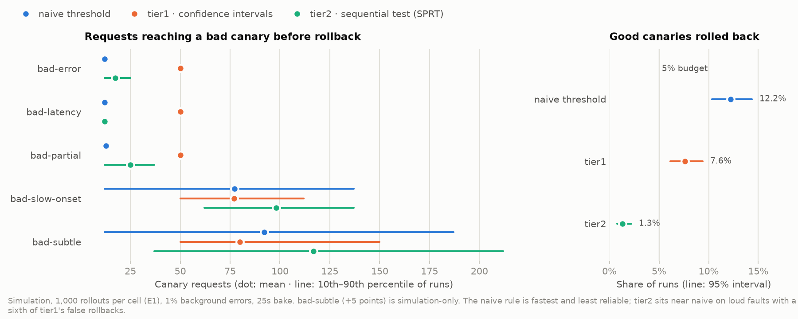
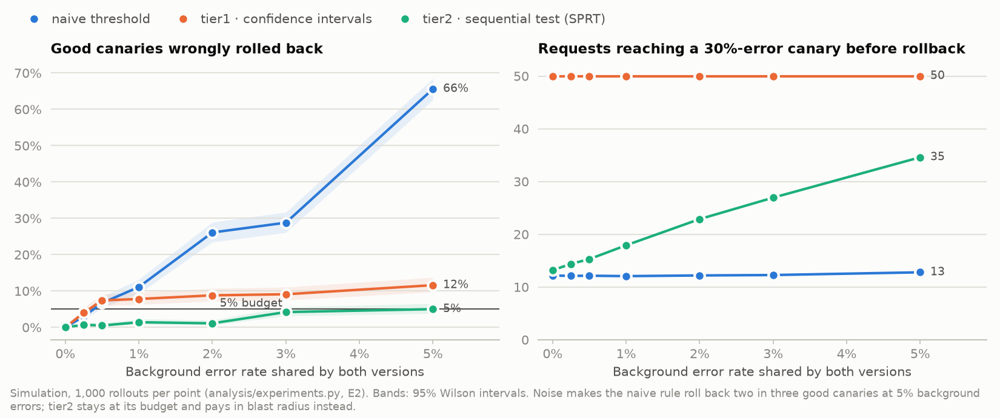
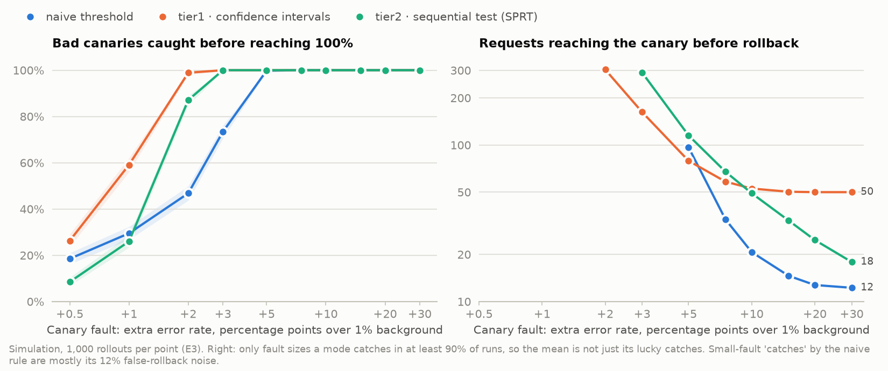
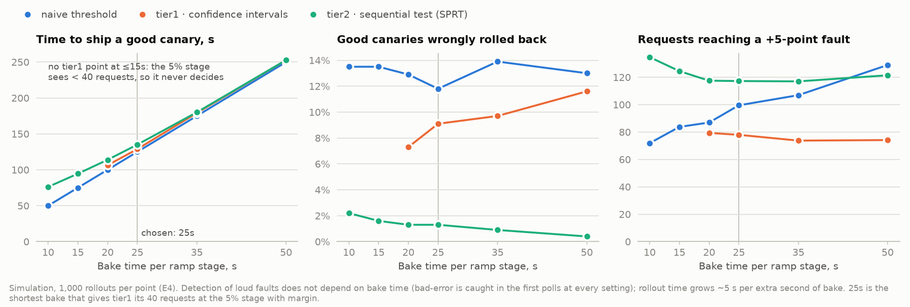
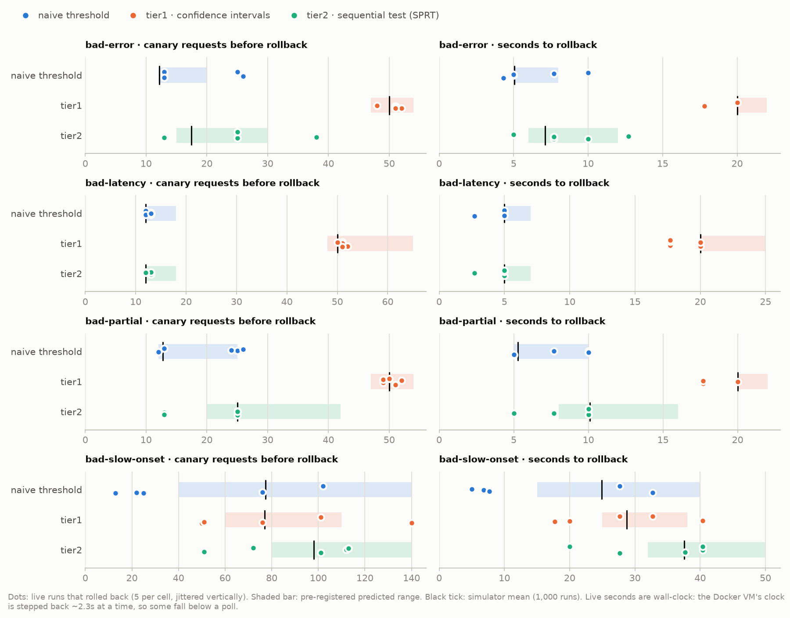
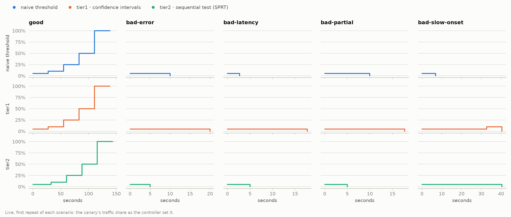

# Experiments and evaluation: results

Three decision rules decide every rollout: **naive threshold** (point estimates against fixed
margins), **tier1** (95% confidence intervals re-tested on a 25s window every poll, with a
40-request minimum) and **tier2** (Wald sequential probability ratio tests on each request's
outcome, with a 5% false-rollback budget split over every test in the rollout). They were compared
two ways:

- **Simulation**: 144,000 rollouts through the controller's real decision and ramp code
  (`analysis/simulate_rollouts.py`), sweeping one parameter per experiment (E1–E4).
- **Live**: 75 runs on the Docker stack, 5 scenarios × 3 modes × 5 repeats, scored against
  predictions committed before the first fault run.

Defaults everywhere: 50 requests/s, 1% background errors on both versions, ramp 5 → 10 → 25 → 50 →
100% with a 25s bake, a decision every 5s.

## Headline results

1. **No bad canary escaped.** 60/60 live fault runs rolled back in every mode, and in simulation
   every mode caught every live fault scenario in all 1,000 runs per cell.
2. **The naive threshold is fast but unsafe for good releases.** It wrongly rolls back **12.2%** of
   good canaries at 1% background errors, and **66%** at 5%. tier1 wrongly rolls back 7.6%, tier2
   **1.3%**, inside its 5% budget at every noise level tested.
3. **tier2 is the only rule that is safe in both directions.** It reaches a 30%-error canary with
   **25 requests live** (18 simulated) against tier1's 51 (50) and naive's 18 (12), while rolling
   back roughly 1 good canary in 77 instead of 1 in 8.
4. **tier1's blast radius is set by its sample floor, not by the data**: 50 ± 1.5 requests on every
   loud fault, live and simulated, because it cannot decide before 40 canary requests.
5. **The prediction file scored 7/8 falsifiable claims and 20/30 per-cell ranges.** Every miss has
   a mechanism (below); two were real bugs the campaign uncovered, since fixed and
   verified live.

## Simulation

All simulation numbers: 1,000 rollouts per cell, fixed seeds (rerunning gives identical results).
Tables: [`simulation/summary.md`](simulation/summary.md); raw: `simulation/*.csv`.

### E1 · every scenario under every mode



| | naive | tier1 | tier2 |
|---|---|---|---|
| **good canary wrongly rolled back** | 12.2% | 7.6% | **1.3%** |
| bad-error (30% errors): canary requests before rollback | 12 | 50 | 18 |
| bad-latency (10× slower) | 12 | 50 | 12 |
| bad-partial (one endpoint, ≈21% overall) | 13 | 50 | 25 |
| bad-slow-onset (errors ramp to 30% over 120s) | 77 | 77 | 98 |
| bad-subtle (+5 points; simulation only) | 92 | 80 | 117 |

tier2 matches naive on latency faults and stays close on loud error faults. It is slowest on
gradual and subtle faults: each stage's test may accept "healthy" before a slow fault has grown,
and its α is split ten ways where tier1 spends ~8% on every rollout.

### E2 · background noise: why naive thresholds fail



| background error rate | 0% | 0.25% | 0.5% | 1% | 2% | 3% | 5% |
|---|---|---|---|---|---|---|---|
| naive: good canaries wrongly rolled back | 0% | 3.0% | 6.7% | 11.1% | 26.1% | 28.8% | **65.6%** |
| tier1 | 0% | 4.0% | 7.4% | 7.8% | 8.8% | 9.1% | 11.6% |
| tier2 | 0% | 0.7% | 0.5% | 1.4% | 1.1% | 4.2% | **5.0%** |

At exactly 0% background errors every rule looks perfect, which is why the stack now runs both
versions at 1% (`BASE_ERROR_RATE`). tier2 holds its budget at every level and pays for noise in
blast radius instead (13 → 35 requests to a 30%-error canary).

### E3 · how small a fault each mode catches



| extra error on the canary | +2 points | +3 | +10 | +30 |
|---|---|---|---|---|
| naive: caught before 100% | 46.8% | 73.4% | 100% | 100% |
| tier1 | **98.9%** | 100% | 100% | 100% |
| tier2 | 87.1% | 100% | 100% | 100% |
| canary requests before rollback (naive / tier1 / tier2) | – | – | 21 / 53 / 49 | 12 / 50 / 18 |

tier1 is the most sensitive to small faults, the flip side of its higher false-rollback rate.
Past +10 points tier2 reaches fewer users than tier1 and approaches naive.

### E4 · bake time: justifying the 25s stage



| bake per stage | 10s | 15s | 20s | **25s** | 35s | 50s |
|---|---|---|---|---|---|---|
| time to ship a good canary (tier2) | 76s | 95s | 114s | 135s | 180s | 253s |
| tier1 | **never decides** | **never decides** | 106s | 129s | 179s | 253s |
| good canaries wrongly rolled back (naive / tier1 / tier2) | 13.5 / – / 2.2% | 13.5 / – / 1.6% | 12.9 / 7.3 / 1.3% | 11.8 / 9.1 / 1.3% | 13.9 / 9.7 / 0.9% | 13.0 / 11.6 / 0.4% |

At ≤15s the 5% stage collects fewer than tier1's 40 requests per window, so tier1 holds forever.
25s is the shortest bake that gives tier1 its floor with margin (~62 requests at 5%). Detection of
loud faults does not depend on bake time; rollout time grows by ~5s per second of bake. Longer
bakes *raise* tier1's false rollbacks (more re-tests per stage) and lower tier2's.

## Live campaign

`results/campaigns/live_20261120T121132Z/`: [`table.md`](../campaigns/live_20261120T121132Z/table.md)
(mean ± sd, variance, range), [`comparison.md`](../campaigns/live_20261120T121132Z/comparison.md),
[`evaluation.md`](../campaigns/live_20261120T121132Z/evaluation.md), and every run's decision log,
request log and timeline plot under `results/archive/`.

| scenario | mode | outcome | seconds to outcome | canary requests (mean ± sd, var) | canary errors served |
|---|---|---|---|---|---|
| good | naive | 5/5 promoted | 136.9 ± 2.3 | 2884 ± 24 (585) | 32.0 |
| good | tier1 | 5/5 promoted | 138.3 ± 0.7 | 2836 ± 51 (2576) | 34.0 |
| good | tier2 | 5/5 promoted | 140.9 ± 3.8 | 2891 ± 31 (950) | 30.8 |
| bad-error | naive | 5/5 rolled back | 6.4 ± 2.4 | 18.0 ± 6.9 (47.0) | 4.2 |
| bad-error | tier1 | 5/5 | 18.6 ± 1.2 | 50.6 ± 1.5 (2.3) | 15.0 |
| bad-error | tier2 | 5/5 | 8.6 ± 2.9 | 25.2 ± 8.8 (78.2) | 6.6 |
| bad-latency | naive | 5/5 | 4.5 ± 1.0 | 12.6 ± 0.5 (0.3) | 0.0 |
| bad-latency | tier1 | 5/5 | 18.6 ± 1.3 | 51.0 ± 0.7 (0.5) | 0.4 |
| bad-latency | tier2 | 5/5 | 4.5 ± 1.0 | 12.6 ± 0.5 (0.3) | 0.4 |
| bad-partial | naive | 5/5 | 7.5 ± 2.5 | 20.0 ± 6.9 (47.5) | 3.8 |
| bad-partial | tier1 | 5/5 | 18.2 ± 1.0 | 50.2 ± 1.3 (1.7) | 11.0 |
| bad-partial | tier2 | 5/5 | 7.5 ± 2.5 | 20.2 ± 6.6 (43.2) | 5.0 |
| bad-slow-onset | naive | 5/5 | 16.0 ± 13.1 | 47.6 ± 39.1 (1532) | 4.0 |
| bad-slow-onset | tier1 | 5/5 | 27.7 ± 9.3 | 83.6 ± 37.9 (1433) | 6.4 |
| bad-slow-onset | tier2 | 5/5 | 33.2 ± 9.1 | 89.8 ± 27.3 (745) | 6.6 |





**The central comparison, both directions** ([`comparison.md`](../campaigns/live_20261120T121132Z/comparison.md)):

| | naive | tier1 | tier2 |
|---|---|---|---|
| bad-error: canary requests before rollback, live | 18.0 | 50.6 | 25.2 |
| same, simulated | 12.1 | 50.0 | 18.0 |
| good: promoted live | 5/5 | 5/5 | 5/5 |
| good: wrongly rolled back, simulated (1,000 runs) | 12.2% | 7.6% | 1.3% |

Five live good runs per mode cannot measure a 1–12% rate (all 15 were promoted, which had a ~33%
chance under the simulated rates); the simulator, running the same decision code, carries that
claim. The live runs confirm the other direction and the simulator's blast-radius estimates.

## Predictions vs results

[`predictions/prediction_20261120T121009Z.md`](../../predictions/prediction_20261120T121009Z.md),
committed at 12:11 UTC before the first fault run; scored mechanically by
`analysis/evaluate_predictions.py` ([`evaluation.md`](../campaigns/live_20261120T121132Z/evaluation.md)).

| claim | result |
|---|---|
| P1. No bad canary escapes | ✅ 60/60 rolled back |
| P2. Loud-fault ordering naive ≤ tier2 < tier1 | ✅ every scenario |
| P3. tier1's blast radius is its 40-request floor (sd < 5, mean 47–54) | ✅ 50.6 ± 1.5, 50.2 ± 1.3 |
| P4. Live exceeds simulated by 1–8 requests for naive/tier2 | ❌ 3 of 4 cells, but bad-partial/tier2 came in *below* (20 vs 25) |
| P5. Slow onset is tier2's worst case; naive the most variable | ✅ |
| P6. tier2 promotes 5/5; naive + tier1 ≤ 2 false rollbacks in 10 | ✅ 5/5; 0 in 10 |
| P7. Good rollouts take 128–150s | ✅ 134–146s |
| P8. Errors served on bad-error: naive < tier2 < tier1 | ✅ 4.2 < 6.6 < 15.0 |

Per-cell ranges: 20/30 live means inside the predicted range.

### What the misses mean

- **P4, bad-partial/tier2.** The simulator's spread for this cell is ±11 requests, so a 5-run mean
  carries ±5 of sampling error; the claim's band (1–8) was narrower than five runs can resolve. A
  lesson about predicting means from small samples, not a model failure: the cell's live mean sits
  inside its predicted range (20–42).
- **Times read 1–2s short (6 cells).** The Docker Desktop VM's clock runs about **8% fast** and is
  stepped back by ~2.3s whenever it drifts from the Windows host (measured: 64.05s monotonic vs
  59.22s host over one minute; 92 backward steps during the campaign). The controller sleeps on the
  monotonic clock (each "5s" poll is ~4.6s real) and logs wall-clock time, so a duration that spans
  a step reads short, sometimes below one poll (bad-latency at 2.7s). In the October runs the same
  VM ran *slow* (+2.7s steps), which the predictions misread as "poll drift".
- **Good runs served ~2,850 canary requests, not ~2,420 (3 cells).** Two mechanisms, both missed:
  the bake is timed on the wall clock, so after a backward step a stage needs one more poll (30
  polls per rollout instead of 25–27, ≈ +400 requests); and 28–110 requests reach the canary at
  100% between the promote decision and the load generator stopping. The extra polls are also why
  good/naive took 136.9s, just past its predicted 128–136s.
- **naive needed a second poll in 5 of its 10 bad-error/bad-partial runs.** In three, its first
  window showed 7–9 canary requests and *0* errors under a 21–31% fault (≈ 3–19% chance each); in
  two it showed no canary requests at all. The canary is a fresh container, so each of its counter
  series (`status="200"`, `status="500"`) does not exist until its first request and appears
  already at 1; Prometheus's `increase()` only counts changes between scrapes, so those first
  increments are invisible to the window-based rules (naive, tier1). tier2 reads raw cumulative
  counters and is unaffected, which is also why it sometimes rolled back while the window still
  showed 0 errors.

### Bugs this uncovered, and fixed

1. **Counter series now exist from startup.** Each service creates its `status="200"` and
   `status="500"` series (and its latency histogram) at 0 when it starts, standard Prometheus
   practice, so `increase()` sees the very first request and error.
2. **Durations now use the monotonic clock.** The controller times the poll schedule and the
   bake on `time.monotonic()` and logs it as `elapsed_s`; wall-clock time is kept only for
   Prometheus query timestamps. Reported time-to-outcome uses `elapsed_s`.

The campaign above predates both fixes. Twelve verification runs after them
([`postfix-counters`](../campaigns/postfix-counters_20261120T142655Z/table.md),
[`postfix-clock`](../campaigns/postfix-clock_20261120T143500Z/table.md)):

| | before (live campaign) | after the fixes | simulator |
|---|---|---|---|
| naive, bad-error: canary requests before rollback | 18.0 ± 6.9; 2 of 5 needed a 2nd poll | **12.6 ± 0.5**; 5/5 at the first poll | 12.2 |
| naive, bad-partial | 20.0 ± 6.9; 3 of 5 needed a 2nd poll | **12.6 ± 0.5**; 5/5 at the first poll | 12.7 |
| good (tier2): polls to promote | 30–32 | **25** (every gap exactly 5.0s) | 25–27 |
| good (tier2): canary requests | 2,891 ± 31 | **2,424 ± 4** | 2,404 |

Every post-fix first poll saw the canary's errors (1–4 of 3–11 requests). Live and simulated
blast radius now agree to within one request for the naive rule. Durations are on the controller's
own clock: on this machine that clock runs ~8% fast against the Windows host, so a 125s rollout is
about 115s of host time, an environment property no in-container clock can correct.

## Evaluation tests

`make eval` (25 tests, ~30s, fixed seeds): tier2 stays within its 5% budget at 0–5% background
errors; the naive rule exceeds it at 1%; tier1's re-testing costs it its nominal α; every mode
catches every live fault; tier2 reaches fewer users than tier1 on loud faults; tier1's blast
radius is its sample floor; tier2 catches its designed effect size; tier1 stalls when the bake is
too short; the simulation is reproducible.

## Reproduce

```bash
make experiments                     # E1–E4 -> results/experiments/simulation/ (~1.5 min)
make eval                            # evaluation tests (~30s)
make campaign                        # live: 75 runs (~2.5 h, needs Docker)
python analysis/evaluate_predictions.py results/campaigns/<campaign>
python analysis/compare_baseline_vs_detector.py --summarize results/campaigns/<campaign>
make figures CAMPAIGN=results/campaigns/<campaign>
```
